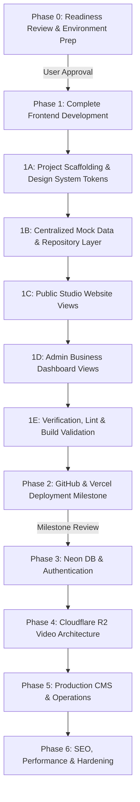

# IMPLEMENTATION PLAN: FIXELORA STUDIO PLATFORM

This document outlines the step-by-step roadmap from Phase 0 to Phase 6, with immediate granular focus on Phase 1 (Complete Frontend Development) and Phase 2 (GitHub & Vercel Deployment).

---

## Roadmap Overview

---

## Detailed Breakdown of Phase 1: Complete Frontend Development

### Step 1.1: Project Scaffolding & Setup
- Initialize Next.js 15 (App Router, TypeScript, ESLint, Tailwind CSS).
- Configure `tailwind.config.ts` and `src/app/globals.css` with semantic color tokens (Cinematic Charcoal `#0A0A0B`, Pure Black `#000000`, Studio Gold `#D4AF37` / `#F0C068`, Muted Gold `#8A743D`, Editorial Greys `#A1A1AA`, `#27272A`).
- Install core UI packages: `lucide-react`, `clsx`, `tailwind-merge`, `framer-motion`, `next-themes`.
- Place and optimize brand identity assets in `/public/brand/`:
  - `fixelora-logo-full.png` / `fixelora-logo-full.jpg` (Full horizontal lockup with tagline)
  - `fixelora-icon-gold.png` (3D metallic gold ribbon play mark)
  - `favicon.ico` / `icon.png`

### Step 1.2: Centralized Mock Data & Type Definitions
- Create `@/types/index.ts` with domain models:
  - `Project` (id, title, slug, client, year, category, tags, runtime, aspect_ratio, description, creative_objective, target_audience, results, original_video_url, playback_video_url, thumbnail_url, featured, is_published, created_at)
  - `Pitch` (id, slug, brand_name, brand_logo, contact_name, title, custom_pitch_note, playback_video_url, thumbnail_url, key_takeaways, valid_until, status, created_at)
  - `BlogPost` (id, title, slug, excerpt, content_markdown, featured_image, category, tags, author, reading_time, is_published, publish_date, cta_variant)
  - `Lead` (id, client_name, company, email, phone, project_type, estimated_budget, timeline, description, track, status, created_at)
  - `StudioSettings` (studio_name, contact_email, phone, address, social_links, max_upload_size_gb)
- Populate `@/lib/data/` with rich, realistic, commercial mock datasets:
  - 8 cinematic projects (Luxury Automotive, High-Fashion DTC, AI Tech Keynote, Premium Spirits, FinTech Commercial, Kinetic Typography Ad, Architectural Film, Sports Heritage).
  - 4 comprehensive editorial articles (e.g., "The Anatomy of a High-Converting 30-Second Commercial", "Color Grading for Luxury Brands: Beyond the Teal-Orange Cliché").
  - 3 targeted outbound private pitches (e.g., "Nike Running Spec Ad", "Aura Sleep Tech Commercial Concept").
  - 6 realistic inbound leads with various budget tiers and project tracks.

### Step 1.3: Public Studio Website Implementation
1. **Root Layout & Navigation (`/src/app/(public)/layout.tsx`):**
   - Floating cinematic header with blurred glass backdrop (`backdrop-blur-md`).
   - Fixelora gold emblem + typography branding.
   - Desktop navigation links: Work (Portfolio), Services, About, Insights (Blog), Contact.
   - Theme toggle button (Dark / Light) with smooth transition.
   - Primary CTA button: "Start a Project".
   - Fullscreen mobile slide-out navigation menu with stagger animation.
   - Studio editorial footer: Global offices, newsletter signup, copyright, social links, legal pages.
2. **Homepage (`/src/app/(public)/page.tsx`):**
   - Full-bleed hero section with silent, auto-playing background showreel loop, bold editorial headline ("CREATIVE ADS. POWERFUL STORIES."), and primary action triggers.
   - Selected Commercial Works: Interactive video card grid with hover-to-preview, category pills, and runtime badges.
   - Studio Philosophy & Impact Stats (e.g., Millions of views generated, Global festival laurels, Brand conversions).
   - Core Production Capabilities (Commercial Ads, Brand Anthems, DTC Social Campaigns, Cinematic 3D).
   - Client Logos / Brand Trust ticker.
   - Editorial Insights section.
   - High-impact closing CTA banner ("Let's make something unforgettable.").
3. **Portfolio Archive (`/src/app/(public)/work/page.tsx`):**
   - Category filter tabs (All, Commercial, DTC / E-commerce, Tech, Narrative, 3D & VFX).
   - Grid/List view toggle.
   - Project cards featuring thumbnail hover video teasers, client name, and category.
4. **Project Case Study Detail (`/src/app/(public)/work/[slug]/page.tsx`):**
   - Full-width cinematic video player container with custom player controls (Play/Pause, Timeline, Volume, Fullscreen, Quality badge).
   - Project metadata sidebar (Client, Year, Deliverables, Director, Aspect Ratio).
   - Editorial Case Study layout:
     - The Challenge & Creative Objective.
     - Target Audience & Strategy.
     - Production Notes & Stills Gallery.
     - Measurable Commercial Results.
   - "Next Project" seamless pagination banner.
5. **Services Page (`/src/app/(public)/services/page.tsx`):**
   - Comprehensive breakdown of studio capabilities: Commercial Advertising, Brand Strategy, High-End Post-Production & Color Grading, Creative Direction.
   - Production timeline & methodology (Discovery -> Pre-Production -> Shoot -> Post & Master).
   - Frequently Asked Questions (FAQ) accordion.
6. **About Page (`/src/app/(public)/about/page.tsx`):**
   - The Fixelora Studio story and creative manifesto.
   - Studio leadership & directors profile cards.
   - Production gear & technical standards (RED, ARRI, Master Anamorphic, Dolby Atmos).
7. **Blog & Insights (`/src/app/(public)/blog/page.tsx` & `/src/app/(public)/blog/[slug]/page.tsx`):**
   - Magazine-style article cards with estimated reading times.
   - Article reader with typography hierarchy, reading progress bar, author card, and injectable sales CTA banner ("Ready to bring your brand story to life?").
8. **Contact & Project Initiation (`/src/app/(public)/contact/page.tsx`):**
   - Dual-Track Selector:
     - Track 1: Interactive Project Brief Form (Multi-step or grouped inputs: Goal, Budget tier, Timeline, File attachments note).
     - Track 2: Direct Discovery Call Booking (Calendar widget embed interface).
   - Studio office coordinates, direct booking email, and response time promise (< 24 Hours).
9. **Private Personalized Pitch Pages (`/src/app/(public)/pitch/[slug]/page.tsx`):**
   - Unlisted, confidential prospect presentation page.
   - Branded header displaying "Fixelora Studio × [Prospect Brand]".
   - Video player loaded with custom speculative commercial.
   - Personalized pitch deck note from the Creative Director.
   - Direct "Schedule Pitch Review" call-to-action button.
   - `noindex, nofollow` meta tags.

### Step 1.4: Admin Dashboard Implementation (`/src/app/admin/`)
1. **Admin Layout & Navigation:**
   - Dedicated dashboard sidebar: Overview, Portfolio, Video/Media, Blog CMS, Leads CRM, Pitches, Settings.
   - Top bar with admin profile indicator, mock session state badge, and "View Live Site" shortcut.
2. **Dashboard Overview (`/src/app/admin/page.tsx`):**
   - Key metrics cards: Active Projects, Total Video Storage Used, Inbound Leads, Active Outbound Pitches.
   - Recent inquiries table with quick status badges.
   - Recent media upload activity.
3. **Portfolio Management (`/src/app/admin/portfolio/`):**
   - Project list table with status badges (Published / Draft), category filters, and search.
   - Project Editor dialog/page: Title, client, category, tags, description, objectives, video asset association.
4. **Media & Video Asset Manager (`/src/app/admin/media/`):**
   - Visual grid and list of studio assets.
   - Multi-asset upload simulator demonstrating the Triple-Asset Workflow (`original_video`, `playback_video`, `thumbnail_image`).
   - Upload progress indicator, file size and format validation, retry simulation, and preview modal.
5. **Blog CMS (`/src/app/admin/blog/`):**
   - Post list with publish status, views, and date.
   - Markdown/Rich-text editor interface with title, slug, excerpt, featured image picker, and injectable CTA selector.
6. **Leads CRM (`/src/app/admin/leads/`):**
   - Inquiries list with filter by status (New, Contacted, In Discovery, Contract Sent, Closed).
   - Detailed drawer/modal viewing client brief, budget, timeline, and lead notes.
7. **Private Pitch Generator (`/src/app/admin/pitches/`):**
   - Pitch list with prospect brand, unique URL copy button, and expiration date.
   - Pitch creation modal: Brand name, video link, personalized message, and custom CTA link.
8. **Admin Settings (`/src/app/admin/settings/`):**
   - Studio profile settings, contact info, social handles, and configurable media upload thresholds (`MAX_UPLOAD_SIZE_GB`).

### Step 1.5: Frontend Verification & Build Validation
- Verify all routes navigate cleanly without runtime errors.
- Confirm zero TypeScript compile errors via `npm run build`.
- Validate responsive styling across mobile (375px), tablet (768px), and widescreen desktop (1440px+).
- Ensure theme switcher functions without hydration errors.

---

## Detailed Breakdown of Phase 2: GitHub & Vercel Deployment

1. **Local Repository Setup:** Initialize Git repository and commit the complete Phase 1 code.
2. **GitHub Remote Integration:** Create or connect the remote GitHub repository (e.g., `fixelora-studio-platform`).
3. **Vercel Project Configuration:**
   - Link repository to Vercel.
   - Configure framework preset (`Next.js`) and root directory.
   - Set environment variables (`NEXT_PUBLIC_APP_URL`, etc.).
4. **Live Verification:**
   - Verify deployment build success on Vercel.
   - Verify live URL, navigation, media embeds, theme toggle, and responsive layouts on public URL.
   - Produce formal Phase 2 Milestone Deployment Report.
